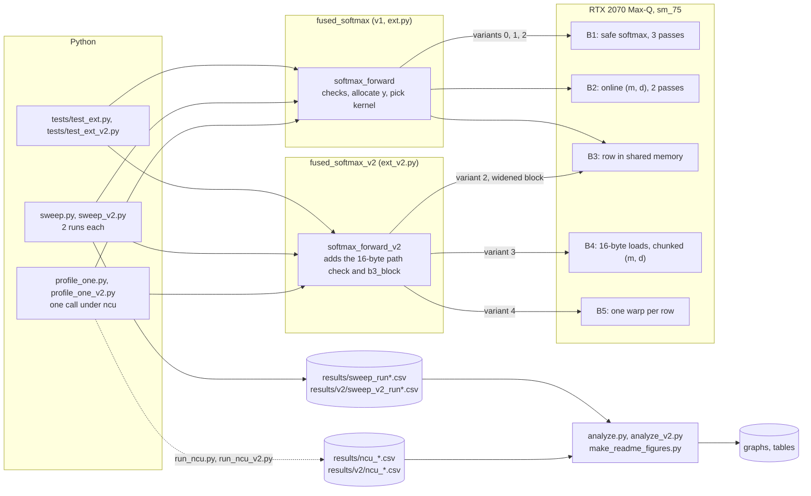
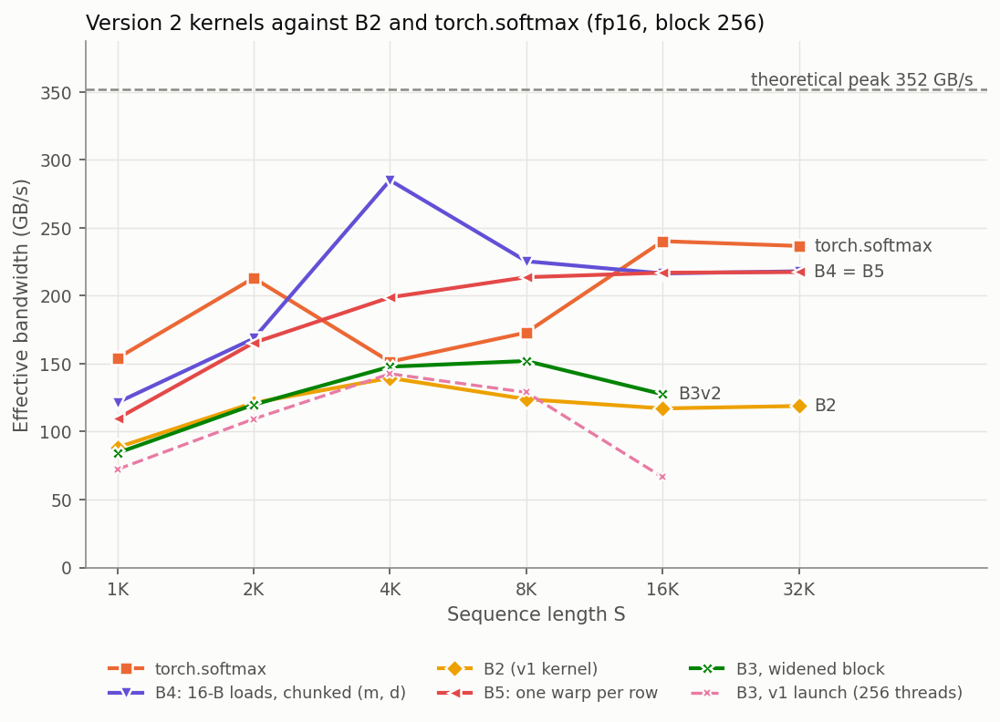

# Fused Online Softmax in CUDA

Hand-written CUDA softmax kernels for fp16, measured against composed PyTorch ops and `torch.softmax` on a laptop GPU with CUDA events and Nsight Compute. Version 1 has three kernels: a 3-pass safe softmax, a 2-pass online softmax and a row-cached variant. Version 2 adds two kernels and a launch fix that apply FlashAttention's inner-loop choices.

The lab asks two questions. Does removing DRAM passes show up in measured DRAM bytes and in time? And what does it cost in extra arithmetic, such as recomputing `exp` or rescaling a running sum?

> **Scope.** This measures the softmax component only and does not claim a FlashAttention result. The S × S score matrix is an input in DRAM, and the probabilities are written back to DRAM.
>
> **Hardware.** All numbers measured on a single NVIDIA RTX 2070 Max-Q laptop GPU (8 GB, Turing, sm_75) with CUDA 12.8 and PyTorch 2.11 on Windows 11. No multi-GPU or datacenter hardware.


**Results at a glance** (S is the sequence length; the input is an S × S fp16 matrix)

- **Fusing works.** At S ≥ 4096 the online kernel B2 is 1.9 to 4.0× faster than the five composed PyTorch ops, and every fused kernel needs one third of the memory.
- **The online kernel removes the pass it should.** Going from B1 to B2 (3 passes to 2) cut DRAM traffic from 7.99 to 6.00 bytes per element at S = 16384, as Nsight Compute measured, and cut time by 17%.
- **Below a 16 KiB row, the L2 cache hides the extra passes.** At S = 2048 and 8192, every v1 kernel moves about 4 bytes per element, whatever its pass count.
- **v1 never got near the bandwidth roof.** B1 and B2 sit at 25 to 41% of DRAM peak at about 98% occupancy, stalled on global-memory loads. Each warp load moved 64 bytes.
- **v2's B4 fixed that.** 16-byte loads and one `(m, d)` rescale per 8 values make it 1.8 to 2.0× faster than B2 at S ≥ 4096. It reaches 94% of DRAM peak at S = 16384. It is 1.9× faster than `torch.softmax` at S = 4096 and 1.3× faster at S = 8192. At S ≥ 16384 it is 9 to 11% slower, because it still moves 6 bytes per element against torch's 4.
- **Fewer bytes did not mean faster until the launch was fixed.** B3 caches the row and reaches the 4-byte floor, but its v1 launch gave 25% occupancy at S = 16384. Widening its block in v2 made it 1.9× faster at the same size.

---

## Contents

1. [High-level design](#1-high-level-design)
2. [The kernels](#2-the-kernels)
3. [Numerical conventions](#3-numerical-conventions)
4. [Interactive visualizers](#4-interactive-visualizers)
5. [Repository layout](#5-repository-layout)
6. [Reproduce](#6-reproduce)
7. [How this was built](#7-how-this-was-built)
8. [Analysis and summary, version 1](#8-analysis-and-summary-version-1)
9. [Version 2: FlashAttention's inner-loop choices](#9-version-2-flashattentions-inner-loop-choices)

---

## 1. High-level design



B1 to B4 use the same launch shape: `grid = rows`, `block = threads` (128 to 1024), on PyTorch's current stream. Block `b` owns row `b`, and thread `t` reads elements `t, t + blockDim.x, t + 2·blockDim.x, ...`. B5 gives each row to one warp instead.


## 2. The kernels

| Kernel | Version | Passes over the row | DRAM model (bytes/elem) | What it does |
|---|---|---|---|---|
| composed PyTorch | | 5 kernels | 16 | `amax`, `x - m`, `exp`, `sum`, `e / d`, each writing a full tensor |
| `torch.softmax` | | 1 kernel | 4 | ATen's fused softmax; picks a different kernel by row length (section 8.5) |
| **B1** safe softmax | v1 | 3 | 8 | thread max → `block_reduce_max` → thread sum of `exp(x - m)` → `block_reduce_sum` → write |
| **B2** online softmax | v1 | 2 | 6 | each thread carries `(m, d)`, merged with `md_combine` in the warp and the block, then one write pass |
| **B3** row cached | v1 | 1 DRAM read | 4 | B2, but pass 1 also copies the row into dynamic shared memory, and pass 2 reads it from there |
| **B3v2** | v2 | 1 DRAM read | 4 | B3's kernel with a block widened until the blocks that fit in shared memory fill the SM |
| **B4** | v2 | 2 | 6 | B2 with 16-byte loads and stores, one `(m, d)` rescale per 8 values, `exp2`, reciprocal multiply |
| **B5** | v2 | 2 | 6 | B4's math with one warp per row: shuffles only, no shared memory, no `__syncthreads` |

The online merge rule, implemented in `md_combine` (with `(-inf, 0)` returned when both maxima are `-inf`, so `exp(-inf - (-inf))` never produces NaN):

```
m = max(m_a, m_b)
d = d_a · exp(m_a − m) + d_b · exp(m_b − m)
```

Knobs: `m.forward(x, variant, block, fast_exp)`. In v1, `variant` 0/1/2 selects B1/B2/B3. In v2, 0 to 4 select B1, B2, B3v2, B4 and B5. `block` is a multiple of 32 up to 1024. `fast_exp` selects at compile time (`if constexpr`): `__expf` instead of `expf` for B1 to B3, and `ex2.approx` instead of `exp2f` for B4 and B5.

B3 is valid only when `2·N + 256` bytes fit in the per-block shared memory opt-in limit. The code reads that limit from the device (`cudaDevAttrMaxSharedMemoryPerBlockOptin`, 65,536 B here) and raises above it. Above 48 KiB of static plus dynamic shared memory, it calls `cudaFuncSetAttribute(..., cudaFuncAttributeMaxDynamicSharedMemorySize, ...)`.

B4 and B5 use the 16-byte path only when `N % 8 == 0` and both pointers are 16-byte aligned. Otherwise they fall back to a scalar loop. `csrc/softmax_kernels_v2.cu` ends with study notes that work through each v2 change with numbers.

## 3. Numerical conventions

- **fp16 overflow.** `exp(x)` passes the fp16 maximum of 65,504 at x ≈ 11.09. The unsafe form `exp(x) / sum(exp(x))` returns `[[nan × 8]]` for `torch.full((1, 8), 30.0)` and `[[nan, 0.0]]` for `[[30.0, 0.0]]`. Every kernel here subtracts the row maximum first and returns `[[0.125 × 8]]` and `[[1.0, 0.0]]`.
- **All -inf rows.** By lab convention, a row that is entirely `-inf` (a fully masked row) returns all zeros. `torch.softmax` returns NaN for that row. Attention kernels need the same rule for fully masked rows.
- **NaN.** `fmaxf` ignores NaN, so a row that contains only NaN and `-inf` returns zeros. A NaN alongside finite values still propagates through the sum.
- **Precision.** Input and output are fp16; `m` and `d` accumulate in fp32. The largest error against a float64 oracle is 6.9e-6 (`randn(8, 1001)`) and 1.5e-5 (`make_input(1024)`). The tests also check a relative tolerance of 1e-3, the size of fp16 rounding.

## 4. Interactive visualizers

Two self-contained pages live in [`docs/`](docs/). To serve them, enable GitHub Pages (Settings → Pages → Deploy from branch → `main` / `docs`).

- [`docs/cuda_softmax_visualizer.html`](docs/cuda_softmax_visualizer.html) shows how rows map to blocks, how threads walk a row and why the loads coalesce, and each step of the warp shuffle (max, sum and `(m, d)`). Its occupancy calculator reproduces the Nsight Compute limits in this repo: 25% and 455 waves for B3 at S = 16384.
- [`docs/flash_attention_visualizer.html`](docs/flash_attention_visualizer.html) steps through FlashAttention's tiled online softmax on a 4 × 12 example. It checks the result against exact attention (error 3e-16), compares per-element and per-tile rescaling, and estimates HBM traffic.

## 5. Repository layout

| Path | Contents |
|---|---|
| `csrc/softmax_kernels.cu`, `csrc/softmax_bindings.cpp`, `ext.py` | v1: reduction helpers, B1/B2/B3, `softmax_forward`; builds `fused_softmax` into `build/` |
| `csrc/softmax_kernels_v2.cu`, `csrc/softmax_bindings_v2.cpp`, `ext_v2.py` | v2: B1/B2/B3 copied from v1, B3 launch fix, B4, B5, study notes; builds `fused_softmax_v2` into `build_v2/` |
| `softmax.py` | Step A: scalar references, float64 oracle, `compare`, composed and torch versions, `bench`, baseline sweep |
| `tests/test_ext.py` | v1: 10 cases × 3 variants × 4 block sizes (absolute, row-sum and relative checks), asserted `fast_exp` cases, B3 at the 48 KiB boundary, six inputs that must raise, timing |
| `tests/test_ext_v2.py` | v2: 15 cases × 5 variants × 4 block sizes, including the 16-byte path and an unaligned input; B4/B5 against B2; the B3 block sizes |
| `sweep.py`, `sweep_v2.py` | 40-cell and 37-cell timing sweeps (`forward` or `reverse` order) |
| `profile_one*.py`, `run_ncu*.py` | one profiled call per cell; 15 v1 and 9 v2 Nsight Compute runs with DRAM read/write bytes and warp stall reasons |
| `analyze.py`, `analyze_v2.py`, `make_readme_figures.py` | ncu CSV parser, graphs and tables |
| `results/`, `results/v2/` | sweeps, clock logs, ncu reports, graphs, `env.txt` |
| `docs/` | the two visualizers |

`build/` and `build_v2/` are not committed: they hold compiler output (`.pyd`, `.o`) that the build regenerates.

## 6. Reproduce

From the x64 Native Tools Command Prompt for VS 2022, with a PyTorch 2.11 + CUDA 12.8 environment:

```bat
set TORCH_CUDA_ARCH_LIST=7.5
python softmax.py                         &:: Step A tests and results\baseline.csv
python tests\test_ext.py                  &:: v1 extension
python tests\test_ext_v2.py               &:: v2 extension

:: second terminal, before each sweep:
:: nvidia-smi --query-gpu=timestamp,clocks.sm,clocks.mem,temperature.gpu,power.draw --format=csv -lms 1000 -f results\gpu_clocks_run1.csv
python sweep.py forward results\sweep_run1.csv
python sweep.py reverse results\sweep_run2.csv
python sweep_v2.py forward results\v2\sweep_v2_run1.csv
python sweep_v2.py reverse results\v2\sweep_v2_run2.csv

:: needs GPU performance counters enabled (NVIDIA Control Panel > Developer); plug in and use Best performance mode
python run_ncu.py
python run_ncu_v2.py
python analyze.py results\sweep_run1.csv results\sweep_run2.csv
python analyze_v2.py results\v2\sweep_v2_run1.csv results\v2\sweep_v2_run2.csv
python make_readme_figures.py results\sweep_run1.csv results\sweep_run2.csv
```

## 7. How this was built

I wrote the version 1 CUDA myself: the warp and block reductions, `md_combine`, the B1, B2 and B3 kernels, `softmax_forward` and its dispatch, the bindings, and the Step A Python (`softmax.py`). I used an AI assistant (Claude) as a tutor and reviewer while writing it. It explained shuffles and masks, reviewed compile errors, and fixed a few small bugs in my code (the `fast_exp` template wiring, an `int` row offset in B3, and a missing prototype).

After v1 was measured, I asked Claude to review it against FlashAttention. It wrote version 2 in a separate file: B4, B5 and the B3 launch fix, with study notes at the end of `csrc/softmax_kernels_v2.cu`. I studied those changes and the numbers behind them before running them.

Claude also wrote most of the measurement tooling: the test extensions, both sweep harnesses, the Nsight Compute scripts, the CSV parser, the charts, the visualizers, and the first draft of this README. Every number in this README comes from the CSVs in `results/`.

---

## 8. Analysis and summary, version 1

All times are CUDA-event medians averaged over the forward and reverse sweep runs, at block 256 with `expf` unless stated.

- **Nsight Compute numbers** come from one profiled call per cell. ncu locks clocks to base, so its times are slower than event times.
- **Effective bandwidth** uses the lab's definition: 4·S² bytes (one fp16 read and one write per element) divided by the time, for every variant.
- **Theoretical peak** is 5,501 MHz × 2 × 256 bit / 8 = 352 GB/s. ncu's own counters agree: a composed kernel reached 322 GB/s at 91.7% of peak.
- **`bench()` zeroes a 16 MiB buffer before each timed call.** That evicts the 4 MiB L2. It also keeps the GPU busy, so the CPU launch delay stays out of the timed window. Times at S ≤ 2048 dropped by about 20 µs against earlier runs without it.

### 8.1 Time and bandwidth

| S | composed | torch.softmax | B1 (3-pass) | B2 (online, 2-pass) | B3 (row in smem) |
|---|---|---|---|---|---|
| 1,024 | 164.5 | 27.9 | 37.3 | 46.5 | 58.1 |
| 2,048 | 291.0 | 81.5 | 126.9 | 136.6 | 153.6 |
| 4,096 | 1,090.1 | 427.0 | 443.2 | 504.0 | 471.0 |
| 8,192 | 4,494.7 | 1,558.8 | 2,317.3 | 2,235.8 | 2,083.7 |
| 16,384 | 17,568.0 | 4,557.7 | 11,238.1 | 9,322.1 | 16,173.6 |
| 32,768 | 141,172.7 | 17,978.8 | 45,424.3 | 35,647.8 | skip (row > smem) |

*Median time per call in µs, lower is better.*

| S | composed | torch.softmax | B1 | B2 | B3 | best v1 kernel / torch |
|---|---|---|---|---|---|---|
| 1,024 | 26 | 151 | 112 | 90 | 72 | 75% |
| 2,048 | 58 | 206 | 132 | 123 | 109 | 64% |
| 4,096 | 62 | 157 | 151 | 133 | 142 | 96% |
| 8,192 | 60 | 172 | 116 | 120 | 129 | 75% |
| 16,384 | 61 | 236 | 96 | 115 | 66 | 49% |
| 32,768 | 30 | 239 | 95 | 120 | skip | 50% |

*Effective bandwidth in GB/s (peak 352).*

**Why.**
- **Composed is flat at about 60 GB/s, but it is not slow per byte.** It moves 15.94 bytes per element, four times the minimum, so 60 GB/s effective is about 240 GB/s of real DRAM traffic. Five reasonably efficient kernels still read and write the matrix five times.
- **At S = 4096, B1 is within 4% of torch.** The extra passes are cheap there, because a row is only 8 KiB and the re-reads stay in L2.
- **From S = 8192 on, torch pulls away.** It uses 16-byte vector loads and keeps the row in registers or shared memory, with 1,024-thread blocks (section 8.5). The v1 kernels use 2-byte scalar loads.

### 8.2 Measured DRAM traffic against the pass model


| variant | S | DRAM B/elem | model B/elem | L2 hit % | DRAM % peak | SM % peak | occupancy % | regs/thread | ncu time (µs) | top stall reasons (warps per issued instruction) |
|---|---|---|---|---|---|---|---|---|---|---|
| composed (5 kernels) | 8,192 | 15.94 | 16 | 39 | 54 | 44 | 93 | 33 | 5,669 | long_scoreboard 10.48; wait 2.13 |
| torch.softmax | 2,048 | 3.79 | 4 | 50 | 50 | 45 | 66 | 80 | 92 | long_scoreboard 3.27; wait 2.00 |
| torch.softmax | 8,192 | 3.99 | 4 | 50 | 35 | 57 | 98 | 35 | 2,167 | not_selected 3.27; math_pipe_throttle 2.11 |
| torch.softmax | 16,384 | 4.00 | 4 | 50 | 50 | 49 | 97 | 41 | 6,136 | not_selected 3.23; long_scoreboard 2.49 |
| B1 | 2,048 | 3.75 | 8 | 50 | 31 | 54 | 97 | 22 | 147 | long_scoreboard 6.15; wait 2.28 |
| B1 | 8,192 | 4.12 | 8 | 71 | 25 | 34 | 97 | 22 | 3,194 | long_scoreboard 15.56; wait 2.20 |
| B1 | 16,384 | 7.99 | 8 | 32 | 41 | 29 | 99 | 22 | 14,787 | long_scoreboard 21.20; wait 2.18 |
| B2 | 2,048 | 3.77 | 6 | 51 | 26 | 71 | 96 | 24 | 176 | long_scoreboard 3.60; wait 1.77 |
| B2 | 8,192 | 4.12 | 6 | 64 | 27 | 49 | 98 | 24 | 2,914 | long_scoreboard 10.04; wait 1.81 |
| B2 | 16,384 | 6.00 | 6 | 33 | 38 | 44 | 99 | 24 | 12,122 | not collected |
| B3 | 2,048 | 3.77 | 4 | 50 | 25 | 72 | 96 | 20 | 183 | long_scoreboard 2.99; wait 1.82 |
| B3 | 8,192 | 3.99 | 4 | 50 | 28 | 58 | 74 | 20 | 2,683 | long_scoreboard 4.44; wait 1.86 |
| B3 | 16,384 | 4.00 | 4 | 56 | 12 | 23 | 25 | 20 | 25,475 | long_scoreboard 4.28; wait 1.81 |

*Table 1 of the lab is the S = 8,192 rows. Every kernel is one launch except composed (5). The B2 row at S = 16,384 comes from the earlier profile: its re-run with stall reasons ran with the GPU at 511 MHz SM and 2.9 GHz DRAM clocks, so it is kept only as `results/ncu_B2_16384_lowclock.csv`.*

**Why.**
- **The model holds once the row stops fitting in L2.** At S = 16384 (32 KiB rows), B1 measures 7.99 against a model of 8 and B2 measures 6.00 against 6.
- **At S = 8192 (16 KiB rows), L2 serves the re-reads.** 36 SMs × 4 resident blocks × 16 KiB ≈ 2.3 MB of rows in flight fits in the 4 MiB L2. B1's hit rate rises to 71%, and its reads fall to 2.13 bytes per element (1.07 reads of each value).
- **The 50% L2 hit rate in the 4-byte rows comes from the writes.** Reads miss and writes land in L2. At S = 2048 the writes measure 1.75 to 1.78 bytes per element instead of 2, because part of the 8 MiB output was still in L2 when the kernel ended.

### 8.3 What limits each variant


| variant | limiter | the ncu number that shows it |
|---|---|---|
| composed | bytes moved and launch count | 5 kernels, 15.94 B/elem; DRAM 54% of peak, the highest of the v1 set |
| torch.softmax | instruction issue | at 8K and 16K the top stalls are `not_selected` and `math_pipe_throttle`: warps are ready and wait for the scheduler, not for memory |
| B1 | global-memory latency | S = 8192: 15.6 warps stalled on loads (`long_scoreboard`) per issued instruction; DRAM only 25% busy at 97% occupancy |
| B2 | global-memory latency, plus extra `exp` work | S = 8192: `long_scoreboard` 10.0; transcendental pipe 29% busy against 20% for B1 |
| B3 | occupancy | S = 16384: shared memory allows 1 block per SM (`launch__occupancy_limit_shared_mem` = 1), so 25% occupancy and 12% DRAM |

B1 and B2 are not bandwidth-bound. DRAM sits at 25 to 41% of peak while about 98% of possible warps are resident, and those warps spend most of their time waiting on loads. Each warp load instruction moves 32 × 2 B = 64 bytes; torch's moves 32 × 16 B = 512 bytes. Version 2 (section 9) tests that diagnosis directly.

### 8.4 Knobs: block size and fast exp (S = 8,192)


| variant | block 128 | block 256 | block 512 | block 1024 | `__expf` at 8,192 | `__expf` at 16,384 |
|---|---|---|---|---|---|---|
| B1 | 2,842 | 2,317 | 1,649 | 2,066 | 2,287 (1.3% faster) | 10,839 (3.6% faster) |
| B2 | 2,354 | 2,236 | 2,033 | 2,344 | 2,010 (10.1% faster) | 8,580 (8.0% faster) |

*Median µs, lower is better.*

**Why.**
- **Block 512 is the best size for both kernels: B1 is 29% faster than at block 256.** Nsight Compute on B1 at block 512 (an earlier profile, whose report was later lost) showed `long_scoreboard` stalls falling by about half, with DRAM bytes nearly unchanged. So the gain came from hiding load latency, not from L2 reuse. Re-run `python run_ncu.py B1 8192 512` to restore the report.
- **`__expf` helps B2 (8 to 10%) more than B1 (1 to 4%).** B2 evaluates about 3 exps per element against 2 for B1.

### 8.5 What `torch.softmax` does differently

The ncu kernel names show that ATen switches strategy with row length:

| S | ATen kernel | block | how it holds the row |
|---|---|---|---|
| 2,048 | `softmax_warp_forward<Half, Half, float, 11>` | 32 × 4 (one warp per row) | registers, 80 per thread |
| 8,192 | `cunn_SoftMaxForwardReg<..., 8>` | 1,024 | registers, 8 halves per thread |
| 16,384 | `cunn_SoftMaxForwardSmem<8, ...>` | 1,024 | shared memory, 32,896 B per block |

Three things separate it from the v1 kernels:
- **16-byte vector loads:** the `8` in the kernel name is halves per load.
- **No shared-memory reduction at small S:** one warp per row.
- **1,024-thread blocks when the row sits in shared memory:** one block already fills the SM.

Version 2 adopts the first and third, and tests the second.

### 8.6 Memory


| S | input | composed | every fused kernel |
|---|---|---|---|
| 1,024 | 2 | 6 | 2 |
| 2,048 | 8 | 24 | 8 |
| 4,096 | 32 | 96 | 32 |
| 8,192 | 128 | 384 | 128 |
| 16,384 | 512 | 1,536 | 512 |
| 32,768 | 2,048 | 6,144 | 2,048 (B3 skipped) |

*Peak GPU memory above the input, in MiB.*

**Why.**
- **Composed needs 3× the input.** It keeps three full-size intermediates alive (`s`, `e`, `y`).
- **It still ran at S = 32768.** The lab predicted it would run out of memory there, but 2,048 + 6,144 MiB fit in this card's usable memory.
- **Every fused kernel allocates only its output.** All variants still grow as S², because the S × S matrix itself is the input.

### 8.7 Relation to FlashAttention

B2 uses the same `(m, d)` recurrence that FlashAttention applies per tile, but a standalone softmax cannot capture the full benefit. Its output is the normalized P, so it needs the final `(m, d)` before writing anything, which forces a second read of the scores. That is why the floor for a streaming kernel here is 6 B/elem. FlashAttention instead accumulates the unnormalized `O = Σ exp(s − m)·v`, rescales it when the max changes, and divides once at the end, so S and P never reach DRAM.

| | v1 kernels | FlashAttention | v2 |
|---|---|---|---|
| rescale unit | per element (2 exps per element in pass 1) | per tile (1 exp per element, plus 1 per row per tile) | per 8 values (1.25 exps per element) |
| on-chip storage | whole row (B3), so occupancy falls as S grows | fixed-size tiles, independent of S | B3 block widened to keep occupancy |
| work split | one row across 8 warps, block-level reduction | rows assigned to warps (FlashAttention-2) | B5: one warp per row |
| exp and normalization | `expf`, divide per element | `exp2` with the scale folded in, divide once at the end | `exp2` via one FFMA, reciprocal multiply |
| saved for backward | nothing | logsumexp per row | nothing |

### 8.8 Run-to-run variation and clock state

- **v1 run spread.** For S ≥ 4096 the forward and reverse runs agree within 12.5% (worst: B3 at S = 8192). Most cells agree within 5%. At S ≤ 2048, calls take 30 to 160 µs and the spread reaches 54% (B3 at S = 1024).
- **v2 run spread.** B4 and B5 agree within 1% at S ≥ 8192. Two cells are noisy: B3v2 at S = 8192 (26%) and B4 at block 1024 (22%).
- **Clocks.** The SM clock peaked at 1,920 MHz, power at 111 W and temperature at 67 °C during the sweeps (`results/gpu_clocks_run*.csv`). The sweep runs a 6-second warm-up before the first cell.
- **Kernel counts.** `kernels_per_call` in `results/sweep_run2.csv` is unreliable. torch.profiler stopped recording kernels after profiling a long call, and `sweep.py` now counts each variant once before timing. The ncu reports confirm 5 kernels for composed and 1 for everything else.

### 8.9 Conclusion (version 1)

On an RTX 2070 Max-Q, softmax at S = 16,384 written the v1 way is limited by global-memory latency, not by DRAM bandwidth. The best kernel (`torch.softmax`) reached 67% of theoretical bandwidth; the best v1 kernel (B2) reached 33% by the lab's definition, or 49% counting its real 6 bytes per element. Nsight Compute puts B1 and B2 at 25 to 41% of DRAM peak at 99% occupancy, with warps mostly waiting on loads. Removing one pass (B1 to B2) changed DRAM bytes per element from 7.99 to 6.00 and cut time by 17%. Caching the row on chip (B3) reached 4.00 bytes per element, but its launch left 25% occupancy, so it was 1.7× slower than B2. The 8 GB limit did not stop the composed version: it ran at S = 32,768 with 6,144 MiB above the input, three times what the fused kernels need.

---

## 9. Version 2: FlashAttention's inner-loop choices



| S | torch.softmax | B2 | B3, v1 launch | B3v2 | B4 | B5 |
|---|---|---|---|---|---|---|
| 1,024 | 27.2 | 47.5 | 58.1 | 49.8 | 34.6 | 38.3 |
| 2,048 | 78.8 | 138.5 | 153.6 | 140.1 | 99.6 | 101.5 |
| 4,096 | 443.5 | 481.3 | 471.0 | 454.3 | **235.6** | 337.7 |
| 8,192 | 1,553.3 | 2,168.4 | 2,083.7 | 1,767.1 | **1,191.6** | 1,257.2 |
| 16,384 | **4,473.2** | 9,176.7 | 16,173.6 | 8,426.9 | 4,963.9 | 4,951.7 |
| 32,768 | **18,159.3** | 36,154.8 | skip | skip | 19,713.1 | 19,764.8 |

*Median µs from the v2 sweeps (mean of two runs, block 256). torch.softmax and B2 were re-timed in the same runs; the "B3, v1 launch" column comes from the v1 sweeps.*

| variant | S | DRAM B/elem | DRAM % peak | SM % peak | occupancy % | regs | ncu time (µs) | top stall reasons |
|---|---|---|---|---|---|---|---|---|
| B3v2 | 8,192 | 3.99 | 31 | 65 | 91 | 20 | 2,475 | long_scoreboard 4.45; wait 1.87 |
| B3v2 | 16,384 | 4.05 | 28 | 62 | 98 | 20 | 11,168 | long_scoreboard 3.74; not_selected 2.27 |
| B4 | 2,048 | 3.74 | 52 | 74 | 92 | 29 | 87 | wait 1.97; not_selected 1.84 |
| B4 | 8,192 | 5.02 | 81 | 46 | 96 | 29 | 1,183 | long_scoreboard 9.65; wait 1.66 |
| B4 | 16,384 | 6.00 | 94 | 38 | 97 | 29 | 4,875 | long_scoreboard 14.09; wait 1.55 |
| B5 | 2,048 | 5.65 | 91 | 37 | 87 | 45 | 78 | long_scoreboard 13.77; wait 1.31 |
| B5 | 8,192 | 6.00 | 93 | 34 | 94 | 45 | 1,241 | long_scoreboard 17.84; wait 1.19 |
| B5 | 16,384 | 6.00 | 93 | 34 | 96 | 45 | 4,931 | long_scoreboard 19.05; mio_throttle 1.24 |

More v2 tables (B3 launch sizes, B4 block sizes, fast exp2) are in [`results/v2/tables_v2.md`](results/v2/tables_v2.md).

**What each change did**

- **16-byte loads plus the per-8 rescale (B4): 1.8 to 2.0× faster than B2 at S ≥ 4096.** DRAM throughput rose to 81% of peak at S = 8192 and 94% at S = 16384, against 27% and 38% for B2. Each warp load now moves 512 bytes, so the same number of waiting warps keeps 8× more bytes in flight. This confirms the section 8.3 diagnosis.
- **B4 against torch.softmax.** B4 is 1.9× faster at S = 4096 and 1.3× faster at S = 8192. At block 512 and S = 8192 it takes 882 µs, 1.76× faster than torch; that cell was not profiled. At S ≥ 16384, B4 runs at 94% of DRAM peak but moves 6 bytes per element against torch's 4. So it takes 9 to 11% longer even though torch only reaches 67% of peak. B4 is now bandwidth-bound, and the remaining gap is the second read.
- **B4 at S = 8192 moves 5.02 bytes per element, more than B2's 4.12.** B2's slow first pass left time for L2 to keep the rows. B4 streams faster, so more of its second-pass reads miss L2.
- **The fast `ex2.approx` changes nothing (under 1%).** Once a kernel is DRAM-bound, cheaper arithmetic does not help.
- **The widened B3 launch (B3v2) restored occupancy.** At S = 16384 it launches 1,024 threads per block, reaching 98% occupancy against 25% before, and runs 1.9× faster than the v1 launch. It still uses 2-byte loads, so DRAM only reaches 28% of peak and it trails B4.
- **One warp per row (B5) did not beat B4 on short rows.** At S = 2048 it moves 5.65 bytes per element, because one warp takes longer to finish a row, so its second-pass reads miss L2 more often. At S ≥ 8192, B4 and B5 run at the same 93 to 94% of DRAM peak and match within 1%. torch's warp kernel keeps the whole row in registers and reads it once, which B5 does not.

**Conclusion (version 2).** The v1 kernels were limited by load latency. Wider loads moved B4 to 94% of DRAM peak, so it is now limited by the bandwidth itself. Past that point the only way to go faster is to move fewer bytes. B3v2 already moves 4 bytes per element and B4 already loads 16 bytes at a time, but neither has both.

**Next steps**
1. Combine B3v2 and B4: cache the row in shared memory with 16-byte loads and the widened block. That gives 4 bytes per element at B4's load efficiency, which the numbers above suggest would beat `torch.softmax` at S ≥ 16384.
2. Keep the row in registers for S ≤ 2048 (one warp per row, 64 values per lane), as `softmax_warp_forward` does.
3. Profile B4 at block 512, and restore the B1 block-512 report.
4. Output logsumexp per row, so the kernel could serve an FA-style backward pass.

## References

- Milakov and Gimelshein, *Online normalizer calculation for softmax*, [arXiv 1805.02867](https://arxiv.org/abs/1805.02867)
- Dao, Fu, Ermon, Rudra and Ré, *FlashAttention: Fast and Memory-Efficient Exact Attention with IO-Awareness*, [arXiv 2205.14135](https://arxiv.org/abs/2205.14135)
- Dao, *FlashAttention-2: Faster Attention with Better Parallelism and Work Partitioning*, [arXiv 2307.08691](https://arxiv.org/abs/2307.08691)
- NVIDIA, [CUDA C++ Best Practices Guide](https://docs.nvidia.com/cuda/cuda-c-best-practices-guide/) (bandwidth formulas)
- NVIDIA, [Nsight Compute Profiling Guide](https://docs.nvidia.com/nsight-compute/ProfilingGuide/) (metric definitions)
