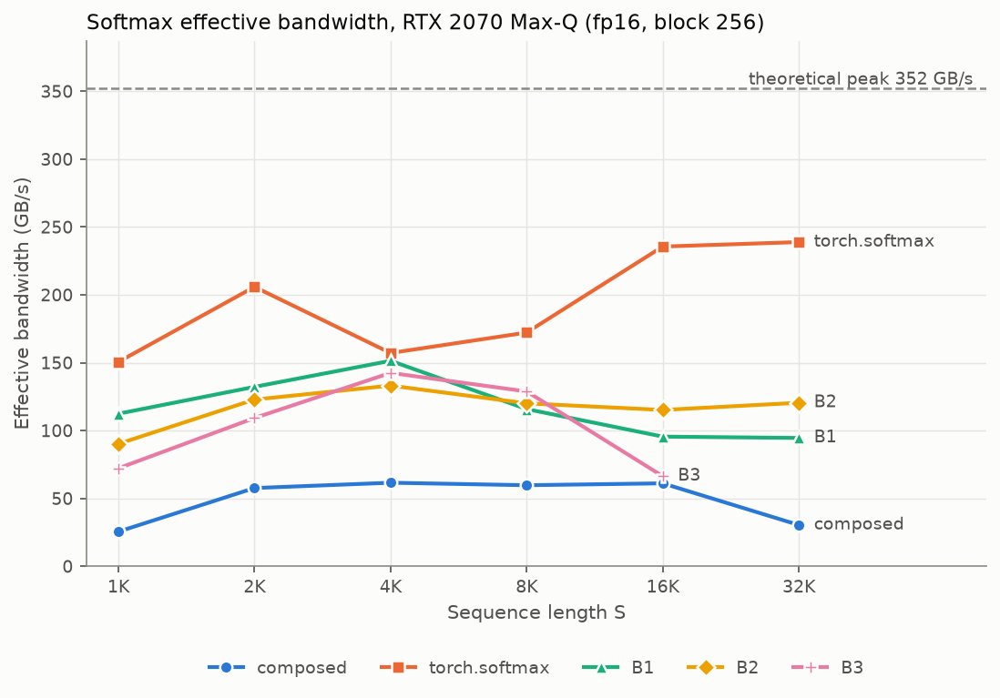
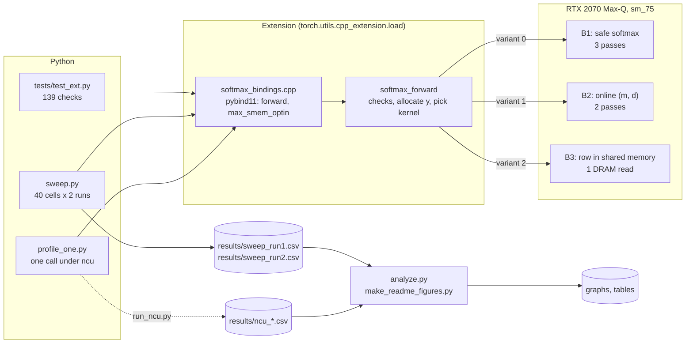
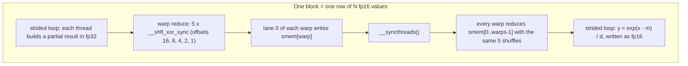
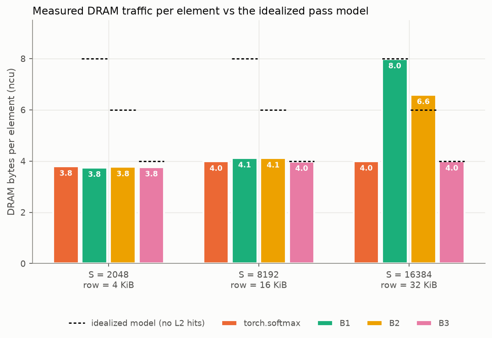
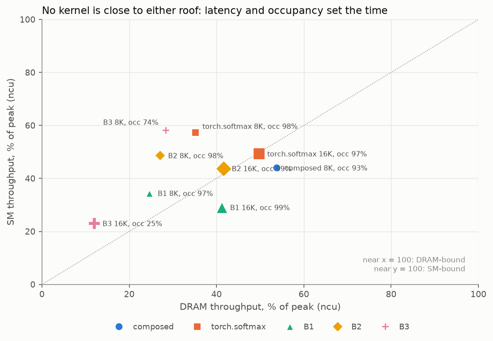
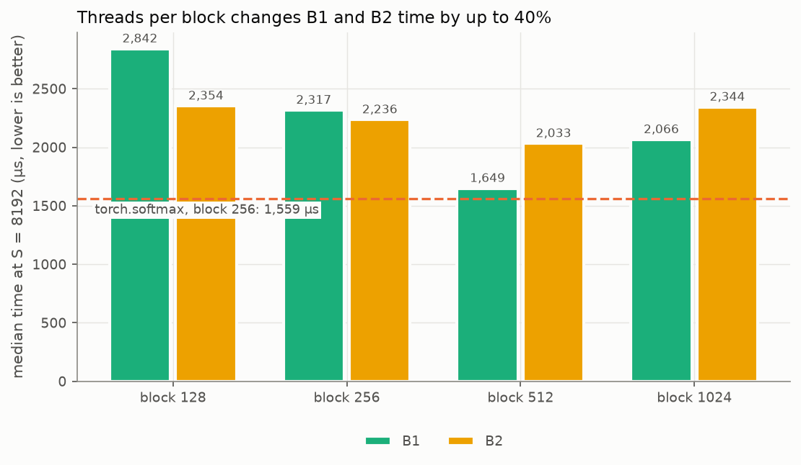
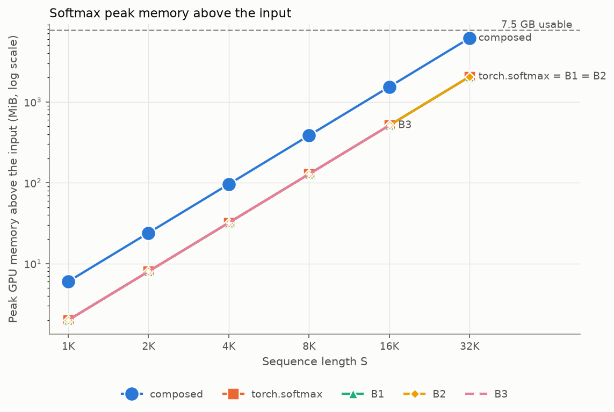

# Fused Online Softmax in CUDA

Three hand-written CUDA softmax kernels (3-pass safe softmax, 2-pass online softmax, and a row-cached variant), measured against composed PyTorch ops and `torch.softmax` on a laptop GPU with CUDA events and Nsight Compute.

The lab asks two questions. Does removing DRAM passes show up in measured DRAM bytes and in time? And what does it cost in extra arithmetic, such as recomputing `exp` or rescaling a running sum?

> **Scope.** This measures the softmax component only and does not claim a FlashAttention result. The S × S score matrix is an input in DRAM, and the probabilities are written back to DRAM.
>
> **Hardware.** All numbers measured on a single NVIDIA RTX 2070 Max-Q laptop GPU (8 GB, Turing, sm_75) with CUDA 12.8 and PyTorch 2.11 on Windows 11. No multi-GPU or datacenter hardware.



**Results at a glance** (S is the sequence length; the input is an S × S fp16 matrix)

- **Fusing works.** At S ≥ 4096 my online kernel (B2) is 1.9 to 3.0× faster than the five composed PyTorch ops, `torch.softmax` is 2.4 to 6.2× faster, and every fused kernel uses one third of the memory.
- **The online kernel removes the pass it should.** Going from B1 to B2 (3 passes to 2) cut DRAM traffic from 7.99 to 6.00 bytes per element at S = 16384, as Nsight Compute measured, and cut time by 19%.
- **Below a 16 KiB row, the L2 cache hides the extra passes.** All kernels move about 4 bytes per element there, whatever the pass count.
- **Fewer bytes does not always mean faster.** B3 reaches the 4-byte floor but is 1.8× slower than B2 at S = 16384, because caching the row in shared memory drops occupancy to 25%.
- **No kernel reaches the bandwidth roof.** `torch.softmax` gets 68% of the 352 GB/s peak. My best kernel (B2) gets 34% by the effective-bandwidth definition, or 51% counting its real 6 bytes per element.

---

## Contents

1. [High-level design](#1-high-level-design)
2. [The kernels](#2-the-kernels)
3. [Numerical conventions](#3-numerical-conventions)
4. [Interactive visualizers](#4-interactive-visualizers)
5. [Repository layout](#5-repository-layout)
6. [Reproduce](#6-reproduce)
7. [How this was built](#7-how-this-was-built)
8. [Analysis and summary](#8-analysis-and-summary)

---

## 1. High-level design



Every kernel uses the same launch shape: `grid = rows`, `block = threads` (128 to 1024), on PyTorch's current stream. Block `b` owns row `b`, and thread `t` reads elements `t, t + blockDim.x, t + 2·blockDim.x, ...`.



## 2. The kernels

| Kernel | Passes over the row | DRAM model (bytes/elem) | What it does |
|---|---|---|---|
| composed PyTorch | 5 kernels | 16 | `amax`, `x - m`, `exp`, `sum`, `e / d`, each writing a full tensor |
| `torch.softmax` | 1 kernel | 4 | ATen's fused softmax. It picks a different kernel by row length (see section 8.5). |
| **B1** safe softmax | 3 | 8 | thread max → `block_reduce_max` → thread sum of `exp(x - m)` → `block_reduce_sum` → write |
| **B2** online softmax | 2 | 6 | each thread carries `(m, d)`, merged with `md_combine` in the warp and the block, then one write pass |
| **B3** row cached | 1 DRAM read | 4 | B2, but pass 1 also copies the row into dynamic shared memory, and pass 2 reads it from there |

The online merge rule, implemented in `md_combine` (with `(-inf, 0)` returned when both maxima are `-inf`, so `exp(-inf - (-inf))` never produces NaN):

```
m = max(m_a, m_b)
d = d_a · exp(m_a − m) + d_b · exp(m_b − m)
```

Knobs: `m.forward(x, variant, block, fast_exp)`, with `variant` 0/1/2 for B1/B2/B3, `block` a multiple of 32 up to 1024, and `fast_exp` choosing `__expf` instead of `expf` at compile time (`if constexpr`).

B3 is valid only when `2·N + 256` bytes fit in the per-block shared memory opt-in limit. The code reads that limit from the device (`cudaDevAttrMaxSharedMemoryPerBlockOptin`, 65,536 B here) and raises above it. Above 48 KiB it calls `cudaFuncSetAttribute(..., cudaFuncAttributeMaxDynamicSharedMemorySize, ...)`.

## 3. Numerical conventions

- **fp16 overflow.** `exp(x)` passes the fp16 maximum of 65,504 at x ≈ 11.09. The unsafe form `exp(x) / sum(exp(x))` returns `[[nan × 8]]` for `torch.full((1, 8), 30.0)` and `[[nan, 0.0]]` for `[[30.0, 0.0]]`. Every kernel here subtracts the row maximum first and returns `[[0.125 × 8]]` and `[[1.0, 0.0]]`.
- **All -inf rows.** By lab convention, a row that is entirely `-inf` (a fully masked row) returns all zeros. `torch.softmax` returns NaN for that row. The convention matches what attention kernels need for fully masked rows.
- **NaN.** `fmaxf` ignores NaN, so a row that contains only NaN and `-inf` returns zeros. A NaN alongside finite values still propagates through the sum.
- **Precision.** Input and output are fp16, while `m` and `d` accumulate in fp32. The largest error against a float64 oracle is 6.9e-6 (`randn(8, 1001)`) and 1.5e-5 (`make_input(1024)`).

## 4. Interactive visualizers

Two self-contained pages live in [`docs/`](docs/). To serve them, enable GitHub Pages (Settings → Pages → Deploy from branch → `main` / `docs`).

- [`docs/cuda_softmax_visualizer.html`](docs/cuda_softmax_visualizer.html) shows how rows map to blocks, how threads walk a row and why the loads coalesce, and each step of the warp shuffle (max, sum and `(m, d)`). Its occupancy calculator reproduces the Nsight Compute limits in this repo: 25% and 455 waves for B3 at S = 16384.
- [`docs/flash_attention_visualizer.html`](docs/flash_attention_visualizer.html) steps through FlashAttention's tiled online softmax on a 4 × 12 example. It checks the result against exact attention (error 3e-16), compares per-element and per-tile rescaling, and estimates HBM traffic.

## 5. Repository layout

| Path | Contents |
|---|---|
| `csrc/softmax_kernels.cu` | reduction helpers, the B1/B2/B3 kernels, `softmax_forward`, `max_smem_optin` |
| `csrc/softmax_bindings.cpp` | pybind11 module |
| `ext.py` | JIT build with `torch.utils.cpp_extension.load` into `build/` |
| `softmax.py` | Step A: scalar references, float64 oracle, `compare`, composed and torch versions, `bench`, baseline sweep |
| `tests/test_ext.py` | 10 cases × 3 variants × 4 block sizes (absolute, row-sum and relative checks against a float64 oracle), asserted `fast_exp` cases, B3 at the 48 KiB boundary and the largest row that fits, six inputs that must raise, and a timing run |
| `sweep.py` | 40-cell timing sweep (`forward` or `reverse` order) |
| `profile_one.py`, `run_ncu.py` | one profiled call per variant, size and block, and the 15 Nsight Compute runs (with exact DRAM read/write bytes and warp stall reasons) |
| `analyze.py`, `make_readme_figures.py` | ncu CSV parser, graphs and tables |
| `results/` | sweeps, clock logs, ncu reports, graphs, `env.txt` |
| `docs/` | the two visualizers |

`build/` is not committed: it holds compiler output (`.pyd`, `.o`) that `ext.build()` regenerates.

## 6. Reproduce

From the x64 Native Tools Command Prompt for VS 2022, with a PyTorch 2.11 + CUDA 12.8 environment:

```bat
set TORCH_CUDA_ARCH_LIST=7.5
python softmax.py                         &:: Step A tests and results\baseline.csv
python tests\test_ext.py                  &:: builds the extension, 139/139 checks

:: second terminal, before each sweep:
:: nvidia-smi --query-gpu=timestamp,clocks.sm,clocks.mem,temperature.gpu,power.draw --format=csv -lms 1000 -f results\gpu_clocks_run1.csv
python sweep.py forward results\sweep_run1.csv
python sweep.py reverse results\sweep_run2.csv

:: needs GPU performance counters enabled (NVIDIA Control Panel > Developer)
python run_ncu.py
python analyze.py results\sweep_run1.csv results\sweep_run2.csv
python make_readme_figures.py results\sweep_run1.csv results\sweep_run2.csv
```

## 7. How this was built

I wrote the CUDA myself: the warp and block reductions, `md_combine`, the three kernels, `softmax_forward` and its dispatch, the bindings, and the Step A Python (`softmax.py`). I used an AI assistant (Claude) as a tutor and reviewer while writing it: it explained shuffles and masks, reviewed compile errors, and fixed a few small bugs in my code (the `fast_exp` template wiring, an `int` row offset in B3, and a missing prototype). It also wrote most of the measurement tooling: the test-table extension, the sweep harness, the Nsight Compute scripts, the CSV parser, the charts, the visualizers, and the first draft of this README. I checked every number in this README against the CSVs in `results/`.

---

## 8. Analysis and summary

All times are CUDA-event medians, averaged over the forward and reverse sweep runs, at block 256 with `expf` unless stated. Nsight Compute numbers come from one profiled call per cell, with clocks locked to base by ncu, so ncu times are slower than event times. Effective bandwidth uses the lab's definition, 4·S² bytes divided by the time (one fp16 read and one fp16 write per element), for every variant. Theoretical peak is 5,501 MHz × 2 × 256 bit / 8 = 352 GB/s, and ncu's own counters agree: a composed kernel reached 322 GB/s at 91.7% of peak.

### 8.1 Time and bandwidth

| S | composed | torch.softmax | B1 (3-pass) | B2 (online, 2-pass) | B3 (row in smem) |
|---|---|---|---|---|---|
| 1,024 | 167.1 | 50.6 | 56.6 | 68.3 | 67.2 |
| 2,048 | 316.7 | 101.5 | 134.6 | 153.8 | 159.6 |
| 4,096 | 1,099.5 | 453.4 | 457.9 | 516.3 | 479.5 |
| 8,192 | 4,401.1 | 1,538.6 | 2,334.3 | 2,151.0 | 2,074.1 |
| 16,384 | 16,866.6 | 4,487.1 | 11,044.5 | 8,934.4 | 15,794.8 |
| 32,768 | 106,698.3 | 17,299.6 | 44,263.3 | 35,463.6 | skip (row > smem) |

*Median time per call in µs, lower is better.*

| S | composed | torch.softmax | B1 | B2 | B3 | best of mine / torch |
|---|---|---|---|---|---|---|
| 1,024 | 25 | 83 | 74 | 61 | 62 | 89% |
| 2,048 | 53 | 165 | 125 | 109 | 105 | 75% |
| 4,096 | 61 | 148 | 147 | 130 | 140 | 99% |
| 8,192 | 61 | 174 | 115 | 125 | 129 | 74% |
| 16,384 | 64 | 239 | 97 | 120 | 68 | 50% |
| 32,768 | 40 | 248 | 97 | 121 | skip | 49% |

*Effective bandwidth in GB/s (peak 352).*

**Why.**
- **Composed is flat at about 61 GB/s, but it is not slow per byte.** It moves 15.94 bytes per element (ncu), four times the minimum, so 61 GB/s effective is about 244 GB/s of real DRAM traffic. Its five kernels are efficient; there are just five of them.
- **At S ≤ 4096 my kernels are within 1 to 25% of torch.** The whole working set sits in or near the 4 MiB L2, so extra passes are cheap.
- **From S = 8192 on, torch pulls away.** It uses 16-byte vector loads and keeps the row in registers or shared memory with 1,024-thread blocks (section 8.5). My kernels use 2-byte scalar loads.

### 8.2 Measured DRAM traffic against the pass model



| variant | S | kernels/call | DRAM B/elem | model B/elem | L2 hit % | DRAM % peak | SM % peak | occupancy % | regs/thread | ncu time (µs) |
|---|---|---|---|---|---|---|---|---|---|---|
| composed | 8,192 | 5 | 15.94 | 16 | 39 | 54 | 44 | 93 | 33 | 5,663 |
| torch.softmax | 2,048 | 1 | 3.79 | 4 | 50 | 50 | 46 | 66 | 80 | 92 |
| torch.softmax | 8,192 | 1 | 3.99 | 4 | 50 | 35 | 57 | 98 | 35 | 2,170 |
| torch.softmax | 16,384 | 1 | 4.00 | 4 | 50 | 50 | 49 | 97 | 41 | 6,113 |
| B1 | 2,048 | 1 | 3.76 | 8 | 50 | 31 | 54 | 97 | 22 | 146 |
| B1 | 8,192 | 1 | 4.12 | 8 | 71 | 25 | 34 | 98 | 22 | 3,190 |
| B1 | 16,384 | 1 | 7.99 | 8 | 25 | 41 | 29 | 99 | 22 | 14,812 |
| B2 | 2,048 | 1 | 3.77 | 6 | 51 | 26 | 71 | 95 | 24 | 175 |
| B2 | 8,192 | 1 | 4.15 | 6 | 64 | 27 | 48 | 98 | 24 | 2,928 |
| B2 | 16,384 | 1 | 6.00 | 6 | 33 | 38 | 44 | 99 | 24 | 12,122 |
| B3 | 2,048 | 1 | 3.77 | 4 | 50 | 25 | 72 | 96 | 20 | 183 |
| B3 | 8,192 | 1 | 3.99 | 4 | 50 | 28 | 58 | 74 | 20 | 2,685 |
| B3 | 16,384 | 1 | 4.00 | 4 | 50 | 12 | 23 | 25 | 20 | 25,499 |

*Table 1 of the lab is the S = 8,192 rows. DRAM bytes come from `dram__bytes.sum.per_second × gpu__time_duration`.*

**Why.**
- **The model holds exactly once the row stops fitting in L2.** At S = 16384 (a 32 KiB row), B1 measures 7.99 against a model of 8 and B2 measures 6.00 against 6.
- **At S = 8192 (16 KiB rows), the L2 serves the second and third reads.** 36 SMs × 4 resident blocks × 16 KiB ≈ 2.3 MB of rows in flight fits in the 4 MiB L2, so B1's hit rate rises to 71% and its traffic falls to 4.12. At S = 16384 the same count is 4.6 MB, which does not fit, and the hit rate drops to 25%.
- **The 50% L2 hit rate in the 4-byte rows is (most likely) the writes.** The reads miss, and the writes land in L2.

### 8.3 What limits each variant



| variant | limiter | the ncu number that shows it |
|---|---|---|
| composed | launch count and bytes moved | 5 kernels and 15.94 B/elem; DRAM 54% of peak, the highest of any variant |
| torch.softmax | memory latency, close to the practical streaming limit for this GPU | 4.00 B/elem, DRAM 50% and SM 49% at 97% occupancy (S = 16,384); 68% of peak by event time |
| B1 | memory latency at small loads, plus a third pass once rows leave L2 | S = 16,384: 7.99 B/elem, yet DRAM only 41% and SM 29% at 99% occupancy |
| B2 | memory latency, plus extra `exp` work | S = 8,192: transcendental (XU) pipe 29% against 20% for B1, and SM 48% against 34% |
| B3 | occupancy | S = 16,384: shared memory allows 1 block per SM (`launch__occupancy_limit_shared_mem` = 1), so 25% occupancy and DRAM at 12% |

None of the custom kernels sits near either roof. DRAM throughput stays at or below 41% and SM throughput at or below 72%, with about 97% occupancy except for B3. That pattern points to too few bytes in flight per warp: each warp load moves 64 B where torch moves 512 B. A warp-stall breakdown in Nsight Compute would confirm it; I did not collect that section.

### 8.4 Knobs: block size and fast exp (S = 8,192)



| variant | block 128 | block 256 | block 512 | block 1024 | `__expf` at 8,192 | `__expf` at 16,384 |
|---|---|---|---|---|---|---|
| B1 | 2,820 | 2,334 | 1,696 | 1,937 | 2,274 (2.6% faster) | 10,641 (3.7% faster) |
| B2 | 2,246 | 2,151 | 1,988 | 2,260 | 2,040 (5.2% faster) | 8,503 (4.8% faster) |

*Median µs, lower is better.*

**Why.**
- **Block 512 is the best size for both kernels, and for B1 it is 27% faster than block 256.** That brings B1 to about 10% behind `torch.softmax` (1,696 against 1,539 µs). One likely reason: with more threads per row, a row's three passes finish closer together, so more of the re-reads hit L2. I have not profiled block 512, so treat this as a hypothesis.
- **`__expf` helps more in B2 (about 5%) than in B1 (about 3%)**, because B2 evaluates about 3 exps per element against 2 for B1.

### 8.5 What `torch.softmax` does differently

The ncu kernel names show that ATen switches strategy with row length:

| S | ATen kernel | block | how it holds the row |
|---|---|---|---|
| 2,048 | `softmax_warp_forward<Half, Half, float, 11>` | 32 × 4 (one warp per row) | registers, 80 per thread |
| 8,192 | `cunn_SoftMaxForwardReg<..., 8>` | 1,024 | registers, 8 halves per thread |
| 16,384 | `cunn_SoftMaxForwardSmem<8, ...>` | 1,024 | shared memory, 32,896 B per block |

Three things separate it from my kernels: 16-byte vector loads (`8` is the halves per load), no shared-memory reduction at small S, and 1,024-thread blocks when the row sits in shared memory. That last point is the fix B3 is missing. The same 32 KiB row costs torch nothing in occupancy because one 1,024-thread block already fills the SM.

### 8.6 Memory



| S | input | composed | torch.softmax, B1, B2, B3 |
|---|---|---|---|
| 1,024 | 2 | 6 | 2 |
| 2,048 | 8 | 24 | 8 |
| 4,096 | 32 | 96 | 32 |
| 8,192 | 128 | 384 | 128 |
| 16,384 | 512 | 1,536 | 512 |
| 32,768 | 2,048 | 6,144 | 2,048 (B3 skipped) |

*Peak GPU memory above the input, in MiB.*

**Why.** Composed keeps three full-size intermediates alive (`s`, `e`, `y`), so it needs 3× the input. The lab predicted it would run out of memory at S = 32768; it did not, because 2,048 + 6,144 MiB fit in this card's usable memory. Every fused kernel allocates only its output. All variants still grow as S², because the S × S matrix itself is the input.

### 8.7 Relation to FlashAttention

B2 uses the same `(m, d)` recurrence that FlashAttention applies per tile, but a standalone softmax cannot capture the full benefit. Its output is the normalized P, so it needs the final `(m, d)` before writing anything, which forces a second read of the scores. That is why the measured floor for a streaming kernel is 6 B/elem here. FlashAttention instead accumulates the unnormalized `O = Σ exp(s − m)·v`, rescales it when the max changes, and divides once at the end, so S and P never reach DRAM.

| | this repo | FlashAttention |
|---|---|---|
| rescale unit | per element (2 exps per element in pass 1) | per tile (1 exp per element, plus 1 per row per tile) |
| on-chip storage | whole row (B3), so occupancy falls as S grows | fixed-size tiles, independent of S |
| work split | one row across 8 warps, block-level reduction | rows assigned to warps (FlashAttention-2) |
| normalization | divide per element | once per row at the end |
| saved for backward | nothing | logsumexp per row |

### 8.8 Run-to-run variation and clock state

- **Run spread.** For S ≥ 4096 the two runs agree within 9.1% (worst case composed at S = 32768). At small S the worst case is 21.4% (`torch.softmax`, S = 2048), where a call takes about 100 µs.
- **Clocks.** The GPU idles at 300 MHz and ramps to 1,920 MHz under load. The sweep runs a 6-second warm-up before the first cell. During the sweeps the SM clock peaked at 1,920 MHz, power at 95 to 106 W, and temperature at 58 °C (`results/gpu_clocks_run*.csv`).
- **L2 at S = 1024.** `bench()` does not flush L2 between calls, and at S = 1024 the 2 MiB input and 2 MiB output fit in the 4 MiB L2. Read the S = 1024 points as partly L2-resident.

### 8.9 Conclusion

On an RTX 2070 Max-Q, softmax at S = 16,384 is limited by memory latency and occupancy, not by DRAM bandwidth. The best kernel (`torch.softmax`) reached 68% of theoretical bandwidth, and my best (B2) reached 34% by the lab's definition. Nsight Compute shows neither roof reached (DRAM ≤ 41%, SM ≤ 44% for B1 and B2) at 99% occupancy, which points at too few bytes in flight per warp with 2-byte loads. Removing one pass (B1 to B2) changed DRAM bytes per element from 7.99 to 6.00 and time by −19%. Caching the row on chip (B3) reached 4.00 bytes per element, but its 25% occupancy made it 1.8× slower than B2. The 8 GB limit did not stop the composed version, which still ran at S = 32,768 with 6,144 MiB above the input, three times what the fused kernels need.

### 8.10 Next steps

From the code review, in order of expected gain:

1. 16-byte `uint4` loads with a scalar tail.
2. B3 with a block size of 1,024 / blocks-per-SM, which restores occupancy up to 32 KiB rows.
3. A per-8-element `(m, d)` update (one rescale per 8 elements), and a reciprocal multiply in the write pass.
4. A warp-per-row path for N ≤ 2048.
5. An optional logsumexp output.
6. Re-run `run_ncu.py`: it now collects `WarpStateStats` (stall reasons) and B1/B2 at block 512, which will confirm or reject the latency and L2 explanations above.

## References

- Milakov and Gimelshein, *Online normalizer calculation for softmax*, [arXiv 1805.02867](https://arxiv.org/abs/1805.02867)
- Dao, Fu, Ermon, Rudra and Ré, *FlashAttention: Fast and Memory-Efficient Exact Attention with IO-Awareness*, [arXiv 2205.14135](https://arxiv.org/abs/2205.14135)
- Dao, *FlashAttention-2: Faster Attention with Better Parallelism and Work Partitioning*, [arXiv 2307.08691](https://arxiv.org/abs/2307.08691)
- NVIDIA, [CUDA C++ Best Practices Guide](https://docs.nvidia.com/cuda/cuda-c-best-practices-guide/) (bandwidth formulas)
- NVIDIA, [Nsight Compute Profiling Guide](https://docs.nvidia.com/nsight-compute/ProfilingGuide/) (metric definitions)
